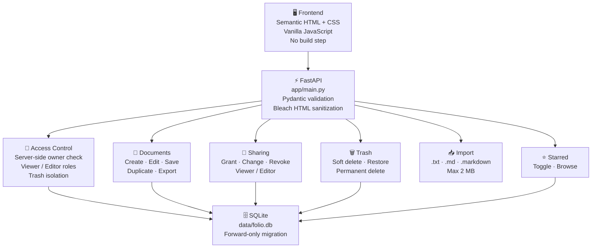
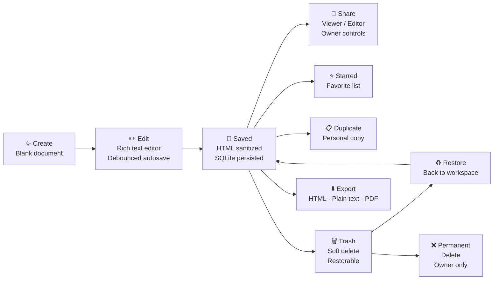

Markdown · folio-readme.md

# 📄 Folio — Shared Document Workspace

     

**A lightweight full-stack document workspace — create, edit, import, share and organize documents with a coherent rich-text experience, server-enforced access control, and no frontend build step.**

*Built for the Ajaia AI-Native Full Stack Developer assignment.*

---

## ✅ Feature Overview

| Area | Features |
| --- | --- |
| **Create & Edit** | Create · rename · edit · save · refresh · reopen documents |
| **Rich Text** | Bold · italic · underline · headings · text size · lists · block quotes · links · horizontal rules · undo / redo |
| **Autosave** | Debounced autosave with visible save state · word/character count · `Ctrl/Cmd + S` manual save |
| **Navigation** | Browser back/forward for document and workspace views · Folio logo + breadcrumb → home |
| **Export** | Download as HTML or plain text · Print / Save PDF via document actions menu |
| **Document Management** | Star/unstar · Starred view · copy · Move to Trash · Restore · Permanent delete |
| **Access Control** | Owner-only rename, trash, sharing — viewer/editor roles enforced server-side |
| **Import** | UTF-8 `.txt`, `.md`, `.markdown` files (max 2 MB) → editable documents |
| **Sharing** | Share with seeded teammates as viewer or editor · change permissions · revoke access |
| **Search & Filter** | Search titles + content previews · filter: All · My Documents · Shared with me · Starred · Trash |
| **Persistence** | SQLite + forward-only migration for Trash field · HTML allow-list sanitization |

---

## 🏗️ Architecture



---

## 🔄 Document Lifecycle



---

## 🚀 Quick Start

```powershell
# 1. Create virtual environment
python -m venv .venv
.\.venv\Scripts\Activate.ps1
pip install -r requirements.txt

# 2. Start server
python -m uvicorn app.main:app --reload --host 127.0.0.1 --port 8081

# 3. Open in browser
# http://127.0.0.1:8081
```

> If port 8081 is unavailable, use `--port 8082` and open the matching URL.

**Custom database path:**

```powershell
$env:DATABASE_PATH = "data/folio.db"
python -m uvicorn app.main:app --reload --host 127.0.0.1 --port 8081
```

The SQLite database is created at `data/folio.db` by default.

---

## 👤 Demo Accounts

> No passwords in this prototype. Use the account selector in the top-right corner to switch identities. Access decisions are made server-side — this is a demonstration mechanism, not production auth.

| Name | Email | Suggested Flow |
| --- | --- | --- |
| Alen Thomas | `alen@demo.local` | Own a document and invite teammates |
| Priya Sharma | `priya@demo.local` | Open a shared document; test view/edit permissions |
| Alex Morgan | `alex@demo.local` | Test a second collaborator |

A sample "Welcome to Folio" document is seeded for Alen.

---

## 📡 API Reference

| Method | Route | Purpose |
| --- | --- | --- |
| `GET` | `/api/documents` | List documents accessible to the selected user |
| `POST` | `/api/documents` | Create a document |
| `GET` | `/api/documents/{id}` | Open a document |
| `PUT` | `/api/documents/{id}` | Save title and sanitized HTML |
| `POST` | `/api/documents/{id}/duplicate` | Create a personal copy |
| `PUT` | `/api/documents/{id}/favorite` | Toggle Starred state |
| `DELETE` | `/api/documents/{id}` | Move an owned document to Trash |
| `GET` | `/api/trash` | List the current user's trashed documents |
| `POST` | `/api/documents/{id}/restore` | Restore an owned document |
| `DELETE` | `/api/documents/{id}/permanent` | Permanently delete a trashed document |
| `POST` | `/api/documents/{id}/shares` | Grant viewer/editor access |
| `PATCH` | `/api/documents/{id}/shares/{email}` | Change a share role |
| `DELETE` | `/api/documents/{id}/shares/{email}` | Revoke access |
| `POST` | `/api/import` | Import `.txt` / Markdown |

---

## 🧪 Tests

```powershell
pytest -q
```

**7 API test functions covering:**

| Test Area | Coverage |
| --- | --- |
| Document lifecycle | Create · update · reopen |
| HTML sanitization | Allow-list enforcement |
| Authorization | Viewer/editor role enforcement |
| Import | Markdown import · unsupported-file rejection |
| Privacy | Private document isolation |
| Trash | Trash · restore · permanent-delete authorization |
| Organization | Starred state · duplication · schema migration |

---

## ☁️ Deployment (Render)

The repository includes `render.yaml` for a Render Blueprint:

1. Connect the repository in Render
2. Create the Blueprint and deploy

> **Note:** The free service uses an ephemeral filesystem — SQLite persists across page refreshes while the instance runs, but can be lost on restart/redeploy. For durable persistence attach persistent storage or migrate to managed Postgres.

Deployment guide: `render.yaml` · Assignment handoff: `SUBMISSION.md`

---

## 🛠️ Tech Stack

| Layer | Technology |
| --- | --- |
| **Backend** | Python 3.11+, FastAPI, Uvicorn |
| **Database** | SQLite (forward-only migration) |
| **Validation** | Pydantic, Bleach HTML sanitization |
| **Frontend** | Semantic HTML, CSS, Vanilla JavaScript — no build step |
| **Testing** | pytest, FastAPI TestClient |

---

## ⚠️ Scope & Limitations

| Area | Current State |
| --- | --- |
| **Collaboration** | No live multi-cursor editing, OT/CRDTs, or comments |
| **Auth** | Demo identity switching only — not production authentication |
| **Rich Text** | Browser `execCommand` API — replace with Tiptap/ProseMirror for production |
| **Database** | SQLite — single-instance demo; use managed Postgres for multi-instance production |
| **Formats** | No DOCX/PDF import, version history, folders, or binary attachments |
| **Security** | No CSRF protection, secure sessions, invitation verification, or audit logs |

---

## 💡 Product Decisions

Document lifecycle and access-control behavior were prioritized over real-time collaboration. Soft-delete is used so accidental deletions can be reversed — permanent deletion is a separate, explicit action. Owner-only actions (rename, trash, sharing) are enforced by the API, not just hidden in the UI.

---

**Built by [Alen Thomas](https://github.com/AIstar007) · Ajaia AI-Native Full Stack Developer Assignment**

[](https://github.com/AIstar007) [](https://linkedin.com/in/alen-thomas-3558bb187/) [](https://portfolio-website-alpha-nine-69.vercel.app/)